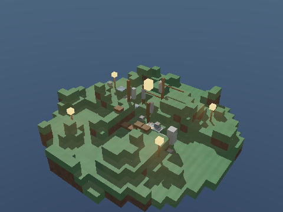

<div align="center">

# Observatorio de la Isla Nocturna

### Diorama voxel en Rust

**Ronald Catùn**  
**19789**




https://youtu.be/7RuO5opyGKg?si=Fh1qfVSJhr1Zq5Fu


</div>

## Sobre el proyecto

Este proyecto crea un pequeño diorama de una isla nocturna. Está escrito en Rust y dibuja la escena con trazado de rayos en el procesador. El terreno, el agua, el observatorio y sus luces se construyen mediante código, sin archivos de texturas externos.

## Cómo abrirlo

Desde la carpeta del proyecto, ejecute:

```sh
cargo run --release -- --interactive
```

Se abrirá una ventana donde podrá explorar la isla. Use los controles de la parte superior para cambiar entre día y noche, y entre calidad normal y bajos recursos. También puede pulsar `C` para alternar entre día y noche.

Para girar la cámara, arrastre con el botón izquierdo del ratón. Si mueve el ratón hacia arriba o abajo mientras arrastra, cambiará el zoom; también puede ajustarlo con la rueda. Pulse `R` para generar una isla nueva; la semilla actual aparece en la parte superior. La cámara conservará su posición. Pulse `S` para guardar una imagen completa como `diorama.ppm` y `Esc` para cerrar la ventana.

El modo de bajos recursos muestra una vista de 120×90 píxeles para que el programa responda mejor en equipos modestos. El modo normal ofrece más detalle y termina de dibujar la imagen al soltar el ratón.

## Guardar una imagen

Si prefiere generar una imagen sin abrir la ventana, ejecute:

```sh
cargo run --release -- 0.0 1.0 diorama.ppm
```

Los argumentos indican el ángulo de la cámara en radianes, el zoom —entre `0.65` y `1.8`— y el nombre del archivo de salida. Puede cambiar el ángulo para obtener otra vista de la isla.

## Crear un video

Para generar un video con una vuelta alrededor del diorama, ejecute:

```sh
./generar_video.sh
```

El script crea los cuadros y los reúne en un video con `ffmpeg`.

## Qué encontrará en la escena

- Una isla de bloques de césped, tierra y roca, con alturas generadas mediante ruido determinista.
- Un observatorio de cristal y madera, un arroyo, piedras, un pequeño puente y varias lámparas.
- Reflejos, refracción, sombras y brillos calculados por trazado de rayos.
- Un cielo que cambia entre día y noche; de noche aparecen estrellas y un disco solar tenue.

## Publicación

Cuando publique el proyecto o el video, puede añadir aquí el enlace correspondiente.
